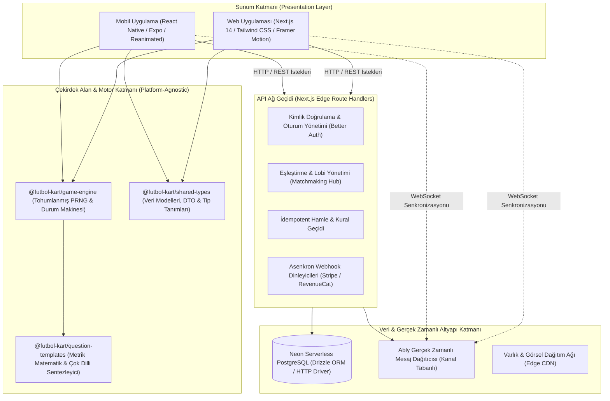

# DerbyGoal Mimari & Mühendislik Dokümantasyonu

[](https://derbygoal.com/)
[](https://play.google.com/store/apps/details?id=com.derbygoal.app)
[](https://nodejs.org/)
[](https://turbo.build/)
[](https://www.typescriptlang.org/)

---

## 1. Yönetici Özeti & Mimari Vizyon

**DerbyGoal**, modern futbol istatistiklerini taktiksel kart stratejisiyle harmanlayan, çok platformlu (Web ve Mobil) üretim seviyesinde bir dijital oyun ekosistemidir. Proje, tek bir TypeScript monorepo yapısı üzerinden hem Web (Next.js 14 App Router) hem de Mobil (React Native / Expo 51+) platformlarında eşzamanlı çok oyunculu, yerel (hotseat) ve yapay zekâlı oturumları çalıştırır.

Sistemin temel mühendislik omurgası **"Sıfır Gereksiz Sunucu Maliyeti ve Yüksek Hata Toleransı"** ilkesine dayanır:
1. **İstemci Tarafında Deterministik Simülasyon (Client-Side PRNG):** Oyun kuralları, zar olasılıkları, yapay zekâ (bot) kararları ve tahta durum geçişleri tohumlanmış (seeded) PRNG motorlarıyla istemcide çözülür. Böylece sunucusuz (serverless) katmanlara sıfır işlem yükü bindirilirken %100 mantık ve görsel tutarlılık sağlanır.
2. **Kusursuz Hata İzolasyonu & Geri Çekilme (Fallback) Zincirleri:** Ağ kopmaları, harici telemetri gecikmeleri veya ödeme sunucusu arızalarında oyun akışı asla kilitlenmez; çevrimdışı durum makinelerine ve bellek önbelleklerine zarifçe rücu eder.
3. **İdempotent & Güvenli Durum Yönetimi:** Menajer hamleleri, para/kumbara hareketleri ve borsa transferleri çakışmaları engelleyen işlem kilitleriyle korunur; mükerrer kesinti veya durum manipülasyonu engellenir.

---

## 2. Üst Düzey Sistem Mimarisi

Aşağıdaki Mermaid.js diyagramı, Clean Architecture ilkelerine göre yapılandırılmış katmanları, veri sınırlarını ve servis entegrasyonlarını özetlemektedir:



---

## 3. Monorepo Dizin Yapısı & Modüler Sınırlar

Proje, sunum katmanlarıyla iş mantığını kesin sınırlarla ayıran bir Turborepo monorepo yapısına sahiptir:

```
futbol-kart/
├── apps/
│   ├── mobile/                 # Mobil Uygulama (Expo SDK 51, React Native)
│   │   ├── src/
│   │   │   ├── components/     # Özel animasyonlu stadyum ve saha bileşenleri
│   │   │   ├── screens/        # Oyun tahtaları, mod seçim ve sonuç ekranları
│   │   │   ├── lib/            # Yerel servisler (IAP, Haptik, Ses Motoru, Durum)
│   │   │   └── i18n/           # 17 dilde yerelleştirilmiş sözlükler
│   │   └── package.json
│   └── web/                    # Evrensel Web Uygulaması (Next.js 14 App Router)
│       ├── src/
│       │   ├── app/            # Edge API uç noktaları, düzenler ve sayfalar
│       │   ├── components/     # Erişilebilir UI ve saha bileşenleri
│       │   └── lib/            # Sunucu tarafı veritabanı vekilleri, Ably tokenları
│       └── package.json
├── packages/
│   ├── game-engine/            # Platformdan bağımsız oyun mantığı, PRNG ve botlar
│   ├── question-templates/     # Metrik soru derleyicileri ve çok dilli dilbilgisi
│   ├── shared-types/           # Saf TypeScript arayüzleri, modeller ve DTO'lar
│   └── db/                     # Drizzle ORM şeması, göçler ve lazy DB vekili
├── turbo.json                  # Görev ardışık düzeni (pipeline) yapılandırması
└── package.json                # Çalışma alanı (workspace) yapılandırması (pnpm v10+)
```

---

## 4. Temel Mimari Prensipler & Hata Toleransı

### 4.1. Deterministik Sahte Rastgele Sayı Üretimi (PRNG)
Çok oyunculu zar atışları, piyon rotaları ve bot taktik kararları için sunucuya sürekli istek göndermek yerine tohumlanmış deterministik PRNG (`createPRNG`) kullanılır:
* Oturumlar paylaşılan bir tohum (seed) değeriyle başlatılır.
* Bot oyuncular hiçbir uzak yapay zekâ servisini çağırmadan insan benzeri düşünme gecikmeleriyle tamamen yerel çalışır.
* Bu mekanizma Vercel ve Neon üzerindeki işlem maliyetlerini sıfıra indirir.

### 4.2. Tembel Yüklenen (Lazy) Veritabanı Vekili
Veritabanı katmanı (`@futbol-kart/db`), Neon PostgreSQL ile uzun süreli TCP bağlantı havuzları yerine HTTP sürücüsü üzerinden konuşur:
* **Cold-Start Önleme:** Sunucusuz Edge fonksiyonlarında bağlantı havuzu beklemesi yaşanmaz.
* **Tembel Yükleme (Lazy Proxy):** Statik derleme (build) sırasında `DATABASE_URL` tanımlı olmasa dahi modül patlamaz; bağlantı yalnızca ilk gerçek SQL sorgusu atıldığında kurulur.

### 4.3. Çift Ödeme Kanalı ve İdempotent Webhooklar
* **Mobil:** RevenueCat SDK üzerinden Google Play kriptografik fiş (receipt) doğrulaması yapılır. İnternet kesilse bile yerel disk önbelleği üzerinden fiyat listeleri gösterilmeye devam eder.
* **Web:** Stripe Checkout sunucu imzalı doğrulama mekanizmasıyla çalışır.
* **İdempotent Webhook Güvencesi:** Webhook dinleyicileri olay ID'lerini (UUID) işlem kilitleri altında kontrol eder; mükerrer gelen bildirimlerin kullanıcıya birden fazla jeton veya yetki yüklemesi matematiksel olarak engellenir.

---

## 5. API Uç Noktaları Tablosu

Aşağıdaki tabloda ana sunucu ağ geçidinin sağladığı temel REST uç noktaları ve hata toleransı mekanizmaları listelenmiştir:

| Metot | Uç Nokta Yolu | Kimlik Doğrulama | Açıklama | Hata Toleransı / Fallback |
| :--- | :--- | :--- | :--- | :--- |
| `POST` | `/api/matchmaking` | Oturum Belirteci | Oyuncuyu reytingine uygun maça kuyruğa alır | Zaman aşımında otomatik olarak çevrimdışı bot maçına devreder |
| `GET` | `/api/match/[matchId]` | Oturum Belirteci | Yetkili güncel maç durum anlık görüntüsünü çeker | DB gecikmelerinde bellek içi anlık durum servis edilir |
| `POST` | `/api/match/[matchId]/move` | Oturum Belirteci | İdempotent hamle gönderimi ve kural doğrulaması | Zaman damgası çakışmasında hamle reddedilir, istemci güncellenir |
| `POST` | `/api/match/[matchId]/ably-token` | Oturum Belirteci | Yetkilendirilmiş geçici WebSocket tokenı üretir | WebSocket bağlantısı başarısızsa HTTP long-polling'e düşer |
| `GET` | `/api/leaderboard` | Genel / Oturum | Küresel ve sezonluk Elo sıralamalarını listeler | Stale-while-revalidate önbelleğiyle DB kesintisinde son veri döner |
| `GET` | `/api/friends` | Oturum Belirteci | Arkadaş listesi, çevrimiçi durumu ve davetleri çeker | Yerel önbelleğe kaydedilmiş liste üzerinden servis edilir |
| `POST` | `/api/webhooks/revenuecat` | Webhook İmzası | Google Play abonelik ve jeton güncellemelerini işler | Olay kimliği kontrolüyle mükerrer bildirimler elenir |
| `POST` | `/api/webhooks/stripe` | Stripe İmzası | Web üzerinden yapılan satın alımları senkronize eder | Kriptografik imza doğrulamasıyla güvenli işlem sağlanır |

---

## 6. Proje Durumu ve Depo Yapısı

> [!NOTE]
> Bu depo, **DerbyGoal** projesinin üst düzey sistem mimarisini, teknik tasarım kararlarını ve mühendislik dokümantasyonunu özetleyen **kamusal (public) vitrin reposudur**. Çekirdek kaynak kodları, tescilli oyun motoru paketleri ve özel altyapı kod tabanları güvenlik ve fikri mülkiyet gerekçeleriyle **özel (private)** depolarda barındırılmaktadır.

### 6.1. Mimari Bileşenler ve Modül Kapsamı

Özel depolarda yer alan monorepo çözümü şu temel katmanlardan oluşmaktadır:
- **`apps/web`**: Next.js 14 App Router, Tailwind CSS ve Framer Motion tabanlı web arayüzü ve API Edge rotaları.
- **`apps/mobile`**: React Native & Expo 51+ tabanlı hibrit mobil istemci.
- **`packages/game-engine`**: Çevrimdışı ve çevrimiçi modlar için tohumlanmış PRNG tabanlı kural ve durum motoru.
- **`packages/shared-types`**: İstemci ve sunucu katmanları arasında paylaşılan TypeScript tür sözleşmeleri ve DTO modelleri.

### 6.2. Üretim ve Entegrasyon Çevreleri

Proje üretim ortamında aşağıdaki harici ve sunucusuz servislerle entegre olarak çalışmaktadır:
- **Veritabanı Katmanı:** Neon Serverless PostgreSQL & Drizzle ORM
- **Gerçek Zamanlı İletişim:** Ably Realtime WebSocket altyapısı
- **Ödeme & Satın Alma:** Web için Stripe, Mobil için RevenueCat entegrasyonu

---

## 7. Resmi Dağıtım & Erişim Bağlantıları

* **Web Uygulaması:** [https://derbygoal.com/](https://derbygoal.com/)
* **Google Play Store:** [DerbyGoal Google Play İndirme Sayfası](https://play.google.com/store/apps/details?id=com.derbygoal.app)

